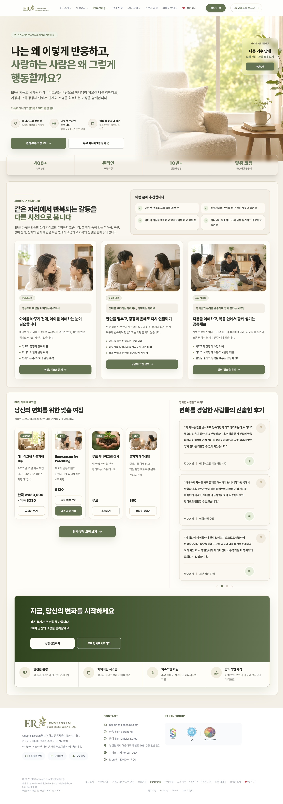
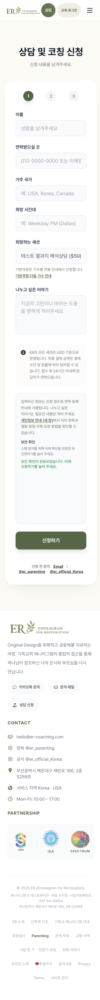

# PostgreSQL 환경과 배포 원장 복구 검증

2026-10-19 KST. PostgreSQL 환경 오류와 원장 저장 실패를 해결했다. 로컬·fresh checkout·GitHub CI 전체549검사 통과, CI site 배포와 원장 PR의 원격 main 저장, 운영 파일·실제 화면 확인까지 완료했다. site 배포 제어·테스트 환경 작업이며 공개 기능 코드·운영 DB·진단 runtime은 변경하지 않았다.

## PostgreSQL 환경

- 기존 실패를 실제 재현했다. `node --test tests/er-consent-concurrency.test.mjs`는 `PG_BIN_DIR is required`로 실패했고, 관련 교육 경쟁 검사는 같은 환경에서 skip됐다.
- [공식 Postgres.app 2.9.6 배포](https://github.com/PostgresApp/PostgresApp/releases/tag/v2.9.6)의 PostgreSQL16.15 도구를 `/Users/jwoo/Applications/Postgres.app`에 설치했다. [다운로드 안내](https://postgresapp.com/downloads.html)는 PostgreSQL16.15를 지원 버전으로 제공한다.
- DMG SHA-256은 GitHub release의 `2689dc64d6a02e0a66e4585616919060d8fbf5bb06886fccc05b7f87638bf081`과 일치했다. `codesign --verify --deep --strict` 통과, `postgres --version`은16.15다.
- 앱 GUI·상시 서비스·운영 DB는 시작하지 않았다. 기존 helper가 `/tmp/edu-pg-*`의 일회용 DB와 전용 Unix 소켓을 만들고 TCP listen을 끈다. 합성 Auth/Storage fixture만 사용하고 종료 후 삭제한다.
- `scripts/run_tests.mjs`와 `npm test`를 추가했다. 명시한 `PG_BIN_DIR` → PATH의 `pg_config --bindir` → 사용자/시스템 Postgres.app 순으로 완전한 도구 경로를 찾는다. 명시한 잘못된 경로는 fallback 없이 실패한다. 외부 DB URL은 허용하지 않는다.
- npm pretest는 기존 `tests/education` 의존성을 별도 lockfile로 `npm ci --ignore-scripts` 설치한다. fresh checkout도 같은 명령으로 검증하며 DB나 런타임 패키지를 새로 추가하지 않는다. 처음 설치와 반복 실행에는 npm registry 접근이 필요하다.

반복 실행 명령이다.

```sh
npm test
```

다른 환경은 공식 PostgreSQL을 설치하고 다음처럼 명시할 수 있다. 환경 변수에는 DB 주소나 비밀번호를 넣지 않는다.

```sh
PG_BIN_DIR="$(pg_config --bindir)" npm test
```

## 원장 생성·저장 경로

- run39139119560 로그의 `GH006: Changes must be made through a pull request`를 확인했다. 직접 main push와 `continue-on-error`가 원인이다.
- 원장 생성기의 기존 정규식이 실제 현재 Site/Test 행과 heading을 바꾸지 못하는 문제도 임시 복제본 CLI 검사로 재현했다. 원장 파일 자체는 로컬에서 고치지 않았다.
- 생성기는 실제 성공한 배포 job만 기록한다. 미배포 Test/Edge 행은 보존한다. full SHA·UTC 검증 시각·실행 URL을 검증하고, 누락된 표/이력·오래된 실행을 거부한다. 동일 실행 재기록은 중복을 만들지 않는다.
- 배포 source를 resolve job에서 한 번 SHA로 고정하고 Site/Test job이 같은 SHA를 checkout한다. 검증 시각은 각 guard 성공 뒤 수집한다. 실패한 트랙을 요청 track만 보고 성공으로 기록하지 않는다.
- 원장 행에는 `source @ full SHA`로 기록해 비-main ref의 복구·preview 배포를 main 소속으로 잘못 표기하지 않는다.
- CI는 원장을 별도 bot 브랜치에 push하고 원장 전용 PR을 생성한다. 저장/PR 생성 실패는 더 이상 무시하지 않는다. PR 생성과 main 영구 저장은 별개 상태로 요약에 표시한다. 원장 PR 병합 전 현재 운영 배포를 확인한다.
- [GitHub 공식 문서](https://docs.github.com/en/actions/how-tos/write-workflows/choose-when-workflows-run/trigger-a-workflow)에 따라 GITHUB_TOKEN의 이벤트 전파에는 제한이 있다. 원장 전용 PR에는 deploy 라벨을 붙이지 않으며 병합이 기능 재배포를 요구하지 않는다. PAT나 새로운 비밀키는 저장하지 않는다.

## 중간 검사

- 신규 원장·CLI·경로 탐색 및 기존 track 검사18/18 통과.
- `PG_BIN_DIR=/Users/jwoo/Applications/Postgres.app/Contents/Versions/16/bin node --test tests/education-concurrency.test.mjs tests/er-consent-concurrency.test.mjs`는7/7 통과, 실패0/skip0.

## 전체 검사·CI·운영 결과

- `npm test`는 **549/549 통과, 실패0, skip0**. PostgreSQL16.15의 동의·정원 경쟁 검사와 새 원장/경로 회귀 검사를 포함한다.
- `npm run check:css`, `node --check scripts/run_tests.mjs`, `node --check scripts/update_deploy_ledger.mjs`, `git diff --check` 통과.
- main 보호 설정을 변경 전 canonical JSON SHA-256 `120b18a97b0d85c71caf7e953dfd8ae30b4227b056a1d1416dbfc36d224e56f2`로 기록했다. 변경 후 다시 비교한다.
- CI 원장 PR을 위해 저장소 Actions의 `can_approve_pull_request_reviews` 설정을 true로 전환했다. GitHub가 PR 생성과 승인을 하나의 설정으로 묶지만 이번 workflow는 PR 생성만 하며 승인이나 자동 병합은 실행하지 않는다. 기본 workflow 권한 read와 main 보호는 유지한다.
- Actions PR 설정은 실제 true로 전환했고 main 보호 JSON SHA-256은 변경 전후 동일했다.
- 기존 node_modules가 없는 별도 fresh clone에서 `npm ci --ignore-scripts` 후 `npm test` **549/549 통과, 실패0/skip0**. npm pretest가 교육 의존성을 준비하는 경로를 실제 확인했다. 기존 Tailwind 개발 의존성 advisory7건은 이전 보고서와 동일하며 이번 작업의 해결 범위가 아니다.
- [PR #180](https://github.com/Jamiewsm/ER-Website/pull/180)의 독립 리뷰2항목을 수정하고 실제 검사 후 해결 처리했다. [최종 Education CI](https://github.com/Jamiewsm/ER-Website/actions/runs/39177855649)·사이트·배포 보호 검사가 통과했다.
- [배포 전 공개20파일 fingerprint](live-before.json)를 확보했다. HTML2개는 Cloudflare beacon script만 제거한 DOMParser 결과로 정규화하고 나머지18개는 원문 바이트를 해시했다.

## 최종 운영 반영

| 구분 | 실제 확인 결과 |
|---|---|
| 기능/CI 수정 PR | [#180](https://github.com/Jamiewsm/ER-Website/pull/180), 2026-10-19 08:48:46 KST 병합, `6d41f16a1fe31deb01c635fb9a6982ad68b91935`. |
| 최종 전체 CI | [Education run39177855649](https://github.com/Jamiewsm/ER-Website/actions/runs/39177855649). PostgreSQL16.15(Ubuntu)에서 root549/549, 실패0/skip0. 별도 교육 패키지205/205도 통과. root 집계와 별도 패키지 집계를 합쳐 중복 없는 총수처럼 표현하지 않는다. |
| 운영 CI 배포 | [run39178073612](https://github.com/Jamiewsm/ER-Website/actions/runs/39178073612), site success / test skipped, 기존 test10파일 보존 로그. Worker `7cd8682d-ab05-482c-9866-3acc3d805ef0`. |
| 운영 guard | CI 08:49:32 KST 성공. 별도 로컬 `node scripts/verify_live_test_deploy.mjs --site https://er-coaching.com`도 배포 후 통과. |
| CI 원장 PR | CI bot이 [#181](https://github.com/Jamiewsm/ER-Website/pull/181)을 생성했고 파일은 `docs/_meta/DEPLOY_LEDGER.md` 하나였다. 현재 source·운영 해시를 확인한 뒤 일반 보호 PR 경로로 병합했다. |
| 원장 영구 저장 | #181은08:53:24 KST 병합, `dfd5051c1413fb726f7de7834ba16cf91313ac2c`. `git fetch origin main` 후 원격 main의 Site 행이 source `6d41f16…`, 검증 시각 `2026-10-18T23:49:32Z`를 담는 것을 확인했다. 원장 merge SHA를 새 배포 SHA로 기록하지 않았다. |
| 보호 규칙 | 변경 전후 main 보호 JSON SHA-256이 모두 `120b18a97b0d85c71caf7e953dfd8ae30b4227b056a1d1416dbfc36d224e56f2`. main 직접 push·관리자 우회·강제 push 없음. |

추가로 보인 run39178131509는 명령이 아닌 issue_comment에서 resolve/deploy/ledger 모두 skipped였다. 새 배포나 원장 저장으로 계산하지 않았다. 최종 실제 배포는 위 run39178073612다.

## 운영 파일·화면 확인

- [배포 전](live-before.json)과 [배포 후](live-after.json)의 공개20파일은 모두 HTTP200이고 해시가 동일하다. site10개와 test runtime10개다. HTML2개는 Cloudflare beacon script만 제거한 DOMParser 결과, 나머지18개는 원문 바이트를 비교했다.
- HTML을 제외한18파일은 로컬 검증 source SHA-256과도 전부 일치했다. `test.html`의 전체 원문 바이트 일치를 주장하지 않으며 정규화 비교와 운영 guard로 확인했다.
- 별도 비인증 Chromium에서 홈1440×1000을 다시 로드하고 실제 상담 신청 버튼을 눌러 `/#apply?track=paid`로 이동했다.
- 운영 신청 화면을320×780으로 전환한 뒤 콘텐츠314px로 가로 넘침 없음, `신청 | ER` 제목, source `paid`, 고정 제출 핸들러 유지, 실제 운영 Turnstile 토큰 발급·보안 확인 완료 상태를 확인했다. 토큰 값은 수집·기록하지 않았다.
- 화면의 Cloudflare iframe 내부 CSP/폰트 로그는 기존 외부 위젯 메시지이며 토큰은 발급됐다. 콘솔 오류가0개라고 주장하지 않는다.
- 임시 PostgreSQL server 프로세스는 종료 후0개였고 fresh-checkout 검증용 임시 복제본과 전용 브라우저 세션은 정리한다. 사용자 로컬 PostgreSQL 도구는 반복 검사를 위해 유지한다.




## 범위와 제한

- 기존 두 미해결 항목은 해결됐다. PG 검사를 skip으로 숨기거나 운영 DB로 대체하지 않았고, ledger job success를 main 저장 성공으로 대신하지 않았다.
- 전체 테스트는 저장소 root의 `tests/*.test.mjs`549개와 별도 교육 패키지 CI205개 범위다. 실제 고객의 신청 저장·메일 수신·새 로그인·역할별 계정 흐름·전체 진단 완료를 수행한 것은 아니다.
- Tailwind3 개발 도구 전이 advisory7건은 이전 검증 보고서의 별도 후속 항목으로 남아 있다. 이번 작업에서 추가된 production dependency나 비밀키는 없다.
- 향후 배포도 CI가 원장 PR을 만든 뒤 조율자가 현재 운영 상태를 확인하고 병합한다. PR이 열려 있는 동안 main 원장이 아직 갱신되지 않은 것은 저장 완료 상태로 보고하지 않는다.
