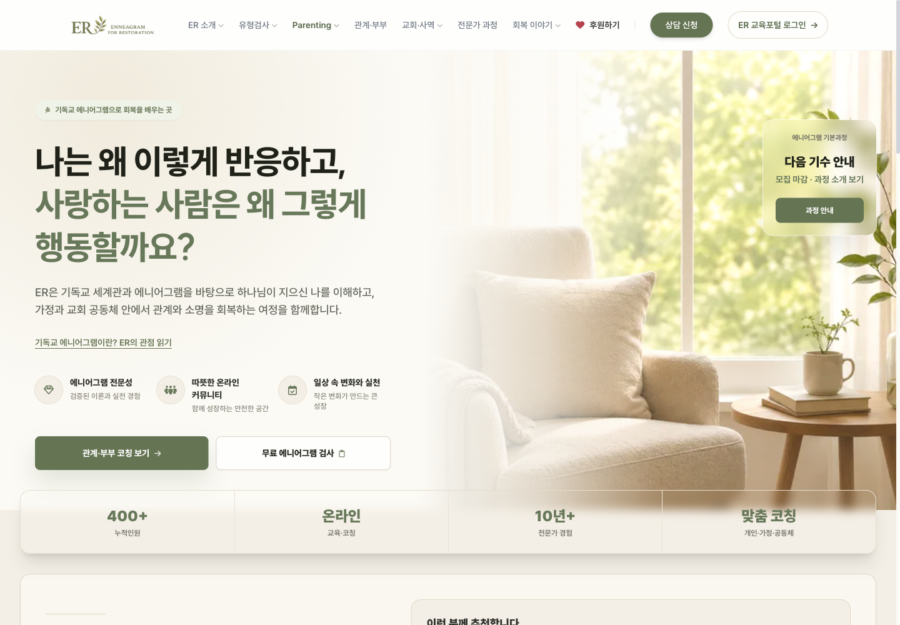
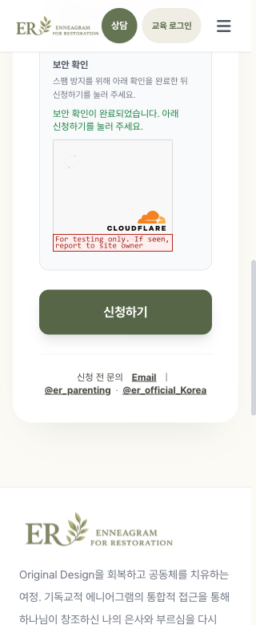
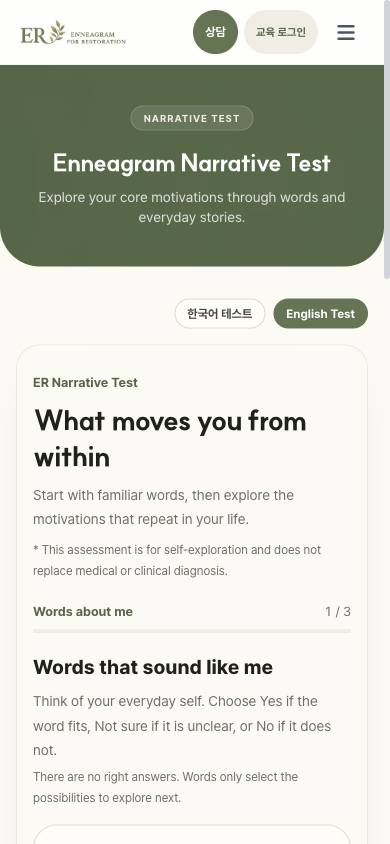

# ER 웹사이트 리뷰 개선 검증

작업 시작 2026-10-18, 로컬 최종 검증 2026-10-19 KST. site 트랙. 운영 데이터·DB·진단 테스트 런타임은 변경하지 않았다.

## 구현 결과

| 리뷰 항목 | 변경 | 로컬 확인 |
|---|---|---|
| R1 신청 URL | track/focus 허용 목록 검증, 데이터 속성 escaping, 정적 제출 핸들러로 분리. 실제 helper를 사용하는 회귀 검사. | 수정 전 새 보안 검사 7개 실패 → 수정 후 통과. 브라우저의 track/focus/apply_source 조작 3종 모두 HTML 표식 삽입 불가. 정상 워크샵 QR source/focus 유지. |
| R2 개인정보 안내 | 세 신청폼의 공통 안내와 새 창 정책 링크, 실제 수집 항목·이용 목적·처리 서비스·권리 요청 연락처 설명. 일반폼 인라인 오류 상태 추가. | 정책 새 창을 열어도 입력 유지. 로컬에서 가로챈 503 응답에 오류 표시·버튼 복구·입력 유지. |
| R3 키보드 메뉴 | native button disclosure, expanded/controls, Enter/Space 열기, Escape/바깥 클릭/Tab 이탈 닫기, 포커스 복귀. 모바일 상태 이름 변경. | 새 회귀 검사 8개 실패 → 통과. 실제 Enter/Space/Escape/바깥 클릭, 모바일 닫기·포커스 확인. |
| R4 작은 화면 | 위젯 컨테이너가 300px 미만이면 compact, 방향 전환 중 크기 모드가 바뀔 때만 재검증. | 초기 320px과 1440→320px 전환 후 콘텐츠314px, 가로 넘침 없음. 작성 내용 유지. 크기 경계 및 재마운트 회귀 검사 통과. |
| R5 효율성 | 동일 장면 WebP/srcset·하단 lazy, 사전 생성한 CSS, 불필요한 Chart/구 검사/코치 스크립트 5개와 홈 테스트 선요청 제거. 공개 화면을 인증 응답 전에 표시. | 이미지 원본6종3,496,122B → 최대 파생6종305,928B,91.2% 감소. 초기 로컬 스크립트37→32개. 정적 CSS61,502B(gzip11,142B). |
| R6 버튼 동선 | individual 목적지의 버튼 2곳을 관계·부부 코칭 보기로 명확화. | 버튼의 문구와 도착 화면 일치. |
| R7 홈 안정성 | 홈에 표시하지 않는 공지 요청과 응답 후 홈 전체 재렌더 제거. | 스크롤900px·포커스·본문1회 렌더 유지 검사. |
| R8 신뢰 수치 | 근거를 확인할 수 없었던98%·4.9/5를 온라인/맞춤 코칭 설명으로 교체. | 실제 화면 반영 확인. 새로운 수치나 조사 근거는 만들지 않음. |
| R9 가격 정책 | 패키지 전환율 문구를 회기별 선택 설명으로 교체. | 관련 프로그램 회귀 검사 통과. |
| R10 제목 | 고정된 화면 라벨로 페이지별 document.title 갱신. | 신청·개인정보·검사 언어·홈 제목과 알 수 없는 route fallback 검사. |

## 검사 명령과 결과

관련 CI 범위 **126/126 통과, 실패0, skip0**.

```sh
node --test tests/seo-foundation.test.mjs tests/site-ministry-boundary.test.mjs tests/basic-course-october-site.test.mjs tests/theology-navigation.test.mjs tests/mobile-site-layout.test.mjs tests/infer-deploy-track.test.mjs tests/application-flow.test.mjs tests/apply-workshop-render.test.mjs tests/program-catalog-routing.test.mjs tests/apply-url-security.test.mjs tests/apply-widget-layout.test.mjs tests/site-navigation.test.mjs tests/site-initialization.test.mjs tests/portal-entry-navigation.test.mjs tests/deploy-safety.test.mjs
```

전체 범위 `node --test tests/*.test.mjs`는 **534개 중532통과,1실패,1skip**. 실패는 변경하지 않은 `er-consent-concurrency.test.mjs`의 독립 PostgreSQL 세션 검사이며 `PG_BIN_DIR is required` 환경 오류다. PostgreSQL 바이너리가 없는 환경에서 운영 DB로 대체하거나 검사를 약화하지 않았다. 전체 검사를 모두 통과했다고 보고하지 않는다.

- `npm run build:css`, `npm run check:css` 통과. 기존 theme 동일, 동적 유형 색상9개 유지. index에 직접 로드되는 JS만 스캔해 독립 테스트 트랙과 분리했다.
- 변경한 JS·빌드 스크립트의 `node --check`, `git diff --check` 통과.
- `npm audit --omit=dev`0건. Tailwind3의 개발 도구 전이 의존성 advisory7건은 호환 범위에 패치가 없어 남아 있다. 해당 npm 코드는 브라우저에 배포하지 않는다. 신뢰할 수 있는 로컬/CI 소스만 빌드한다.
- npm 최초 설치는 기존 root node_modules의 미등록 패키지177개를 정리했다. 소스·기존 테스트 패키지는 보존했다.
- CSS/이미지/보안 helper/초기화 파일의 site 배포 판정과, 이전/최적화 홈 모두에 대한 배포 보호 검사 통과. 진단 런타임 보호 검사는 유지했다.

## 실제 브라우저 확인

Playwright Chromium의 별도 비인증 로컬 세션. 1440×1000,390×844,320×780.

- 홈의 기존 색·서체·배치 유지, 바뀐 CTA·신뢰 설명 확인.
- 신청 URL의 비실행 표식 3종은 DOM에 생기지 않으며 source는 paid, 이벤트는 고정 핸들러로 유지.
- 일반/양육 신청과 닫힌 기본과정 진입. 개인정보 새 창에서 기존 폼 유지.
- 서버 오류는 Playwright가 로컬에서 가로챘다. 실제 신청 API에 테스트 신청을 저장하거나 이메일을 발송하지 않았다.
- 위젯은 로컬 세션에서만 [Cloudflare 공식 테스트 sitekey](https://developers.cloudflare.com/turnstile/troubleshooting/testing/)로 표시했다. 테스트 키는 소스/운영 설정에 넣지 않았다.
- 한국어→영어 검사 iframe, 다른 화면 이동 후 동일 iframe·언어 유지 확인. 전체 검사를 끝내거나 진단 정확성을 재검증한 것은 아니다.
- 독립 코드 리뷰에서 OAuth callback hash를 너무 일찍 지울 수 있는 순서 문제를 발견했다. URL 정리를 인증 SDK 완료 뒤로 옮기고 실패→통과 회귀 검사로 검증했다. 로그인 자격 증명과 실제 Google 로그인은 사용하지 않았다.





## 운영 반영 상태

현재 기록 시점에는 로컬 검증을 완료했다. PR·CI·운영 파일 및 화면 확인 결과는 후속 검증 기록에 추가한다. 실제 신청 저장·메일 수신·로그인 후 역할별 검증은 수행하지 않는다.
