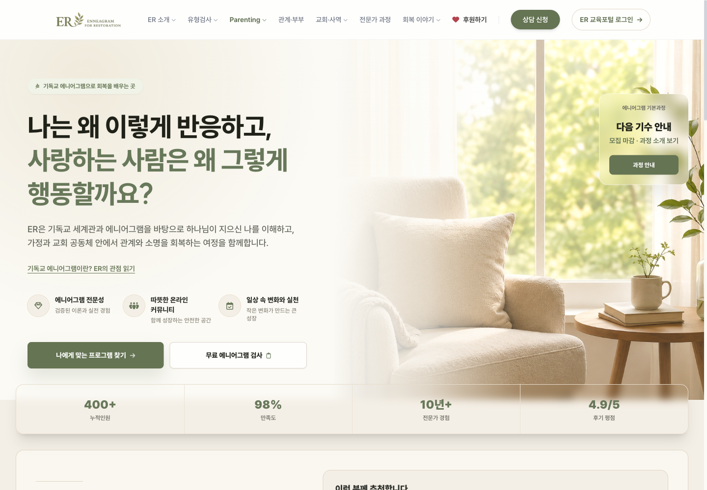
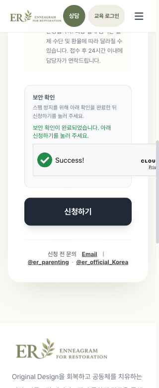

# ER 웹사이트 리뷰

2026-10-18 · 운영 사이트 https://er-coaching.com · 소스 기준 `origin/main e4f0157`.

**ER은 브랜드의 분위기와 교육 콘텐츠가 잘 갖춰져 있습니다. 다음 발전의 중심은 방문자가 자기 상황에 맞는 도움을 빠르게 찾고, 안심하고 신청하도록 만드는 데 두는 것이 좋겠습니다.** 신청 URL 처리의 보안 문제를 먼저 수정하고, 접근성·모바일 신청·로딩 비용을 순서대로 개선할 것을 권합니다.

## 영역별 평가

| 영역 | 평가 | 좋은 점 | 보완할 점 |
|---|---|---|---|
| 디자인 | 좋음 | 올리브 그린·아이보리, SUIT/Pretendard, 여백과 사진의 톤이 일관됩니다. 기독교적 정체성과 회복이라는 방향이 분명합니다. | 여러 페이지가 큰 히어로와 카드 묶음으로 반복됩니다. 핵심 선택보다 설명·장식이 먼저 보이는 구간이 있습니다. |
| 기능 | 공개 진입은 양호, 신청 안전성 보완 필요 | 한국어·영어 검사, 아이 관찰 검사, 목적별 신청, 모집 마감 안내, 교육포털 연결이 마련돼 있습니다. | URL 입력 처리에 HTML 삽입 경로가 있습니다. 실제 신청 저장·알림·회원 로그인까지의 성공은 이번에 검증하지 않았습니다. |
| 효율성 | 개선 효과가 큰 영역 | 정적 사이트 중심이라 운영 인프라가 작고, 디자인 토큰·프로그램 카탈로그·회귀 검사를 재사용할 수 있습니다. | 큰 이미지, 초기 전체 스크립트 로딩, 브라우저에서 CSS를 생성하는 방식이 첫 방문 비용을 높입니다. |
| 사용성 | 기본기는 좋음, 선택 동선 보완 필요 | 질문형 첫 문장, 구체적인 양육 사례, 가격 표시, 신청 항목의 사전 선택이 이해를 돕습니다. | 광범위한 버튼 문구와 좁은 도착 화면, 키보드 하위 메뉴, 작은 화면의 보안 위젯, 개인정보 안내가 보완 대상입니다. |

점수는 매기지 않았습니다. 실제 이용자의 과업 성공률·이탈률·문의 전환 데이터를 확인하지 않았으므로, 수치 점수보다 관찰과 검증 수준을 구분했습니다.

## 유지할 장점

- **정체성.** 홈에서 기독교 세계관을 밝히고, 신학적 기초를 별도 읽기 페이지로 제공합니다. Parenting의 “아이의 성향만 분석하지 않는다”는 설명도 서비스의 관점을 잘 전달합니다.
- **현실적인 문제 언어.** 양육·부부·사역팀의 반복되는 갈등을 구체적인 장면으로 설명해 방문자가 자기 상황을 대입하기 쉽습니다.
- **검사 안내.** 단어를 후보 탐색에 사용한다는 설명, 임상적 진단을 대신하지 않는다는 안내, 아이 결과를 유형 가설로 다루는 경계가 있습니다. 이는 검사 정확성 검증과는 별개로 좋은 안내입니다.
- **모집 상태 관리.** 운영 홈과 기본과정 페이지에 10월 기수 모집 마감과 다음 기수 문의 경로가 표시됩니다. 오래된 로컬 코드에 있던 모집 상태 문제는 현재 결함에서 제외했습니다.
- **기술 기반.** 공개 페이지의 뒤로가기·새로고침이 정상 동작했고, 현재 신청폼의 라벨은 입력란에 연결되어 있습니다. 기존 자동 검사도 활용할 수 있습니다.



## 먼저 해결할 문제

P1은 우선 수정, P2는 다음 개선 작업, P3는 콘텐츠·품질 정리입니다. “운영 확인”은 실제 화면/DOM 또는 내려받은 운영 파일에서 확인한 사항입니다.

| ID | 중요도 | 문제 | 영향과 최소 개선 |
|---|---|---|---|
| R1 | **P1** | 신청 URL 값이 HTML 이벤트 속성에 직접 들어갑니다. | 조작된 링크가 신청 화면의 HTML 구조에 영향을 줄 수 있습니다. `track/focus` 허용값을 검증하고 입력값의 인라인 이벤트 보간을 제거합니다. |
| R2 | **P2** | 개인정보 입력 시점의 안내가 부족합니다. | 일반 신청폼에 정책 링크가 없고, Privacy 페이지는 상세 정책을 추후 작성한다고 안내합니다. 수집 목적·보관/삭제 기준·문의 방법을 구체화하고 입력 위치에서 연결합니다. |
| R3 | **P2** | 데스크톱 하위 메뉴가 키보드로 열리지 않습니다. | Tab이 하위 항목을 건너뜁니다. 클릭·키보드로 열리는 메뉴와 `aria-expanded`, Escape 닫기를 제공합니다. 모바일 메뉴 상태 안내도 함께 보완합니다. |
| R4 | **P2** | 320px 신청 화면에서 보안 확인 위젯이 잘립니다. | 콘텐츠 폭이 366px로, 화면보다 46px 넘칩니다. 좁은 컨테이너에서 compact 위젯을 사용하도록 조정합니다. |
| R5 | **P2** | 홈의 첫 로딩에 불필요한 비용이 있습니다. | 큰 배경 이미지와 초기 전체 스크립트 로딩을 줄이고, CSS를 미리 생성합니다. 아래 성능 수치를 기준으로 전후 비교합니다. |
| R6 | **P2** | “나에게 맞는 프로그램 찾기”가 관계·부부 화면으로 연결됩니다. | 양육이나 교육을 찾는 방문자가 다시 메뉴를 탐색해야 합니다. 버튼을 “관계·부부 코칭 보기”로 정확히 바꾸거나, 부모·개인/부부·교회·배우기의 단순한 선택 링크를 제공합니다. |
| R7 | **P2** | 공지 응답 후 홈 전체를 다시 렌더링합니다. | 응답이 늦으면 읽던 위치와 포커스가 바뀔 수 있습니다. 공지 영역만 갱신합니다. 현재 소스의 VM 재현에서 스크롤 900px → 0px을 확인했습니다. 운영에서 사용자 스크롤 중 재현한 결과는 아닙니다. |
| R8 | **P3** | 만족도·평점 숫자의 근거를 화면에서 확인하기 어렵습니다. | “98%”, “4.9/5”에 조사 기간·응답 수·집계 기준이 보이지 않습니다. 확인 가능한 근거를 짧게 붙이고, 근거가 없는 수치는 정성적 설명으로 바꿉니다. 허위 수치라고 판단한 것은 아닙니다. |
| R9 | **P3** | 고객 화면에 운영자 관점의 문구가 있습니다. | 가격 정책의 “패키지 전환율이 높고”는 신청자가 알아야 할 정보와 거리가 있습니다. 회기별 목표·맞는 대상·취소/변경 안내처럼 선택에 필요한 내용으로 교체합니다. |
| R10 | **P3** | 여러 화면의 브라우저 제목이 같습니다. | 프로그램·양육·신청·이야기 화면을 구분하기 어렵습니다. 화면별 제목을 적용하고, 검색/공유가 중요한 콘텐츠는 기존 정적 페이지 패턴으로 확장합니다. |

### R1. 신청 URL 처리

**운영 파일과 동일한 최신 소스에서 비실행 HTML 삽입을 재현했습니다.** URL 해시(`/#apply?...`)의 `track` 값이 `submitSource`를 거쳐 `<form onsubmit="...">`에 직접 들어가고, 결과 문자열을 `main.innerHTML`에 대입합니다.

- 근거 경로. `js/app-core.js:8–11` → `js/sections/apply.js:625–626,633` → `js/app-helpers.js:730–732` → `js/sections/apply.js:732` → `js/app-core.js:142`.
- 재현. 실제 소스를 Node VM에 로드하고 무해한 `<span data-er-audit-inert-probe>` 표식만 전달했습니다. 표식이 이벤트 속성 밖의 HTML로 생성됐습니다.
- 판단. HTML 삽입이 확인된 DOM XSS 위험 경로입니다. 실행형 스크립트, 개인정보 접근, 실제 공격은 수행하지 않았습니다.
- 수정 방향. 지원하는 `track/focus`를 허용 목록으로 정규화하고, 이벤트는 정적인 핸들러/이벤트 리스너로 연결합니다. HTML escaping만으로 이벤트 안의 JavaScript 문자열까지 안전해진다고 가정하지 않습니다.
- 완료 기준. 따옴표·태그·예상 밖 route 값이 DOM 구조나 실행 코드를 만들지 않고, 정상적인 각 신청 링크는 기존 세션 선택을 유지해야 합니다.

### R2–R4. 신청과 접근성

**개인정보 안내.** 실제 [Privacy 화면](https://er-coaching.com/#privacy)은 “더 자세한 정책은 추후 별도 문서로 정리할 예정입니다”라고 안내합니다. 민감한 고민을 적는 서비스인 만큼, 완결된 안내와 입력 단계의 정책 링크가 신뢰에 도움이 됩니다. 이는 정책 내용과 사용성에 대한 발견이며 법적 적합성 판단은 아닙니다.

**키보드 메뉴.** 데스크톱 “ER 소개”에 포커스를 두어도 하위 메뉴는 `display:none`, `aria-expanded`는 없습니다. Tab을 누르면 “유형검사”로 넘어갑니다. 운영 마크업은 `hidden group-hover:block`입니다. 신학적 기초 등의 페이지가 다른 위치에서도 연결되더라도 주 메뉴 자체의 키보드 동작은 보완해야 합니다. 모바일 메뉴도 열려 있는 동안 버튼 이름이 “메뉴 열기”로 유지되고 Escape로 닫히지 않았습니다. 근거는 `index.html:367–455`, `js/app-core.js`의 모바일 메뉴 처리입니다.

**작은 화면.** 검사 iframe은 320px에서 가로 넘침이 없고 제목도 제공됩니다. 반면 일반 상담 신청폼은 320px에서 위젯이 잘립니다. `js/api.js:62`는 `size:'flexible'`을 사용하며, 공식 문서에서 flexible의 최소 너비는 300px, compact는 150px입니다. 폼의 내부 여백을 고려해 좁은 컨테이너에는 compact를 적용하는 작은 변경이 적절합니다. [Cloudflare 위젯 크기 문서](https://developers.cloudflare.com/turnstile/get-started/client-side-rendering/widget-configurations/).



### R5. 로딩과 유지보수 효율

| 측정/분석 | 현재 값 | 해석 |
|---|---|---|
| 데스크톱 홈 첫 방문의 리소스 | 66개, 전송량 4,337,582바이트 | 한 브라우저·한 번의 비제한 네트워크 관찰입니다. LCP나 실제 사용자 평균은 아닙니다. |
| 같은 방문의 DOM 준비 / load | 약 1.61초 / 2.27초 | 절대 성능 등급으로 사용하지 않고 개선 전후의 참고값으로 사용합니다. |
| 홈 배경 `background.png` | 2,338,747바이트 | 이미지 하나가 약 2.34MB입니다. 화면 크기에 맞는 압축 포맷 제공의 효과가 큽니다. |
| 홈이 참조하는 고유 이미지 6개 | 합계 3,496,122바이트 | 소스 자산 합계이며 모든 환경에서의 실제 전송량과 동일한 뜻은 아닙니다. |
| 초기 로컬 스크립트 | 37개, 원본 638,462바이트 | 압축 전 합계입니다. 홈을 보는데 코치 업무 모듈까지 읽습니다. |

권장 순서입니다.

1. 히어로에 화면별 WebP/AVIF와 크기를 제공하고, 화면 아래 이미지에만 지연 로딩을 적용합니다. 히어로 자체를 지연 로딩하지 않습니다.
2. `cdn.tailwindcss.com`을 미리 생성한 정적 CSS로 교체합니다. 기존 토큰과 JS 템플릿의 동적 클래스가 빠지지 않게 확인합니다. 운영 콘솔에도 경고가 있으며, 공식 문서는 Play CDN을 개발용으로 안내합니다. [Tailwind 공식 문서](https://v3.tailwindcss.com/docs/installation/play-cdn).
3. 코치·관리자·차트 코드를 해당 기능 진입 시 불러옵니다. 서버 권한 검사는 계속 유지합니다. 코드 지연 로딩은 접근 권한 보호 수단이 아닙니다.
4. 공개 본문과 인증 초기화를 분리합니다. `js/app-init.js:87,93`, `js/auth.js:163`에서 인증 지연이 공개 화면 표시에도 영향을 줄 수 있습니다. 이는 코드상 조건부 위험이며 현재 운영 장애로 확인하지 않았습니다.

근거는 `index.html:69–72,744–785`, `js/sections/home.js:235,305,343,397`입니다. 현재 구조를 유지하면서 개선할 수 있습니다.

## 디자인과 동선의 발전 방향

### 첫 화면의 우선순위

홈의 질문형 제목과 색감은 유지할 가치가 있습니다. 모바일 390×844에서는 “프로그램 찾기”가 약 y=782px, “무료 검사”가 y=849px에 있어 두 번째 핵심 행동은 첫 화면 아래에 놓입니다. 제목·설명 다음에 행동 버튼을 먼저 배치하고, 모집 안내와 신뢰 요소를 뒤로 옮기는 작은 실험을 권합니다.

“나에게 맞는 프로그램 찾기”를 유지하려면 도착 화면에 최소한 다음 선택이 함께 보여야 합니다.

| 방문 목적 | 다음 화면 |
|---|---|
| 나와 관계를 이해하고 싶음 | 개인·부부 코칭 |
| 아이와의 관계를 돕고 싶음 | Parenting |
| 교회·사역팀을 돕고 싶음 | 교회·사역 프로그램 |
| 에니어그램을 체계적으로 배우고 싶음 | 기본과정·전문가 과정 |

기존 페이지를 연결하는 단순한 링크로 충분합니다. 실제 방문자의 선택을 확인한 뒤 메뉴 재편 범위를 결정하면 됩니다.

### 신뢰를 만드는 정보

숫자와 반복되는 “검증된” 표현보다, 누가 어떤 방식으로 돕는지 확인할 수 있는 정보가 더 필요합니다. 이미 있는 코치 소개와 연결하고, 동의를 받은 사례에는 이용 서비스·변화 장면·후기 수집 시점을 제공하면 좋겠습니다. 만족도 근거는 보유 여부부터 확인해야 합니다.

프로그램 카드는 대상·진행 방식·시간·가격·다음 행동을 같은 순서로 보여주면 비교가 쉬워집니다. 서비스별로 중요한 차이를 살리고, 긴 설명은 상세 화면에서 이어 읽도록 정리할 수 있습니다.

## 실행 우선순위

| 분류 | 작업 묶음 | 완료 기준 |
|---|---|---|
| BUILD NOW 1 | R1 입력 처리 안전성 | 조작된 route로 마크업 생성 불가, 정상 목적별 신청 유지, 관련 회귀 검사 통과. |
| BUILD NOW 2 | R2–R4 신청 신뢰·접근성 | 정책 링크/안내 제공, 키보드 메뉴 열기·닫기, 320/390px 위젯 표시 및 제출 전 상태 안내 확인. |
| BUILD NOW 3 | R5·R7 로딩과 화면 안정성 | 이미지 전송량 감소, 공지 응답 뒤 스크롤·포커스 유지, CSS 사전 생성의 화면 회귀 확인. |
| BUILD NOW 4 | R6·R8·R9 안내 문구 | 버튼과 도착 화면의 범위 일치, 수치 근거 확인, 운영자 관점 문구 정리. |
| EXPERIMENT | 모바일 첫 화면의 버튼 순서 | 처음 방문하는 3–5명이 양육/코칭/교육 중 필요한 경로를 설명 없이 찾는지 관찰. |
| BACKLOG | R10 페이지별 제목·주요 서비스의 독립 URL | 먼저 제목을 보완하고, 실제 검색 수요가 확인된 페이지부터 기존 정적 URL 패턴을 적용. |

인프라나 프레임워크를 새로 늘릴 필요는 현재 근거에서 보이지 않습니다. 먼저 위 작업들을 독립적으로 검증·배포할 수 있는 작은 변경으로 진행하는 것이 유지보수에 유리합니다.

## 검증과 범위

- 운영 화면을 1440×1000, 390×844, 일부 320×780에서 확인했습니다. 실제 모바일 기기의 Safari 검증은 아닙니다.
- 홈, 관계·부부, 교회·사역, Parenting, 전문가 과정, 후원, 회복 이야기, Privacy, 기본과정, 신학 페이지, 성인/아이 검사 진입, 일반/마감 신청 진입, 교육포털 로그인 화면을 확인했습니다.
- 프로그램 화면에서 뒤로가기와 새로고침 후 화면 복원을 확인했습니다.
- 최신 소스의 `app-core.js`, `home.js`, `apply.js`, `app-helpers.js`는 브라우저로 받은 운영 파일과 SHA256이 일치했습니다. 레포 전체의 운영 일치를 확인한 것은 아닙니다.
- 홈에서는 앱 JavaScript 오류가 없고 Tailwind 경고가 있었습니다. 신청 화면에서 나타난 Turnstile 내부 로그·CSP 오류는 위젯이 성공 상태에 도달한 사실과 구분했으며, 신청 실패로 집계하지 않았습니다.
- **관련 자동 검사 80개 통과, 실패·건너뜀 0.** 실제 신청 데이터 저장, 이메일 발송/수신, 인증 후 역할별 동작, 전체 검사 완료와 결과의 정확성, 검색 순위는 이번 리뷰의 검증 결과에 포함되지 않습니다.
- 구현 코드는 수정하지 않았습니다. 이번 산출물은 리뷰 문서와 공개 화면의 스크린샷입니다.

검증 명령입니다.

```sh
node --test tests/seo-foundation.test.mjs tests/site-ministry-boundary.test.mjs tests/basic-course-october-site.test.mjs tests/theology-navigation.test.mjs tests/mobile-site-layout.test.mjs tests/infer-deploy-track.test.mjs tests/application-flow.test.mjs tests/apply-workshop-render.test.mjs
```

자세한 재현·파일 일치 근거는 [evidence.md](evidence.md)에 기록했습니다.
